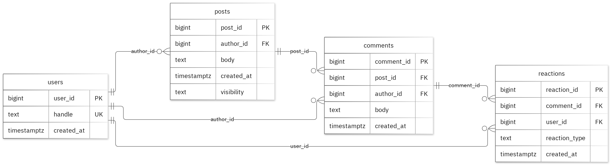

# Social Media Comment System

**MIT 8103 · Advanced Database Systems**
**Author:** Lateef Olaleye · **Student ID:** 301930160

A relational and document-database design for a social media platform where members publish posts, comment on posts, and react to comments. The project covers relational modelling in **PostgreSQL**, query optimisation, transactions and concurrency, an event-oriented **MongoDB** model, and a distributed/cloud design discussion.

---

## Case Study

**Domain:** Social Media / Comment System

The database supports members who publish posts, comment on posts, and react to comments. It uses four tables: `users`, `posts`, `comments` and `reactions`.

**Supported operations**

- Create and retrieve posts and comments
- Find recent comments on a post
- Count reactions on comments, grouped by post
- Add a reaction while preventing duplicate reactions by the same member on the same comment

---

## Portfolio Overview

| # | Portfolio | Focus | Key result |
|---|-----------|-------|------------|
| 1 | Database Design and Modelling | Keys, constraints, normalisation | 13 invalid inserts rejected, valid rows unchanged |
| 2 | Query Processing and Optimisation | Joins, indexing, query plans | Median lookup 0.786 ms → 0.144 ms |
| 3 | Transactions and Concurrency | COMMIT, ROLLBACK, isolation, locking | `SELECT FOR UPDATE` preserved all increments |
| 4 | NoSQL and Advanced Data Models | MongoDB `comment_events` | 4 events inserted, 4 queries verified |
| 5 | Distributed and Cloud Exercise | Replication and sharding (discussion) | 3 replica members across failure zones |

---

## Portfolio 1: Database Design and Modelling

The relational design is organised into **4 tables**. Primary keys identify records, foreign keys preserve the links between them, and check constraints enforce the business rules.

- **Business rule:** a comment body must contain between **1 and 2000 characters**.
- **Normalisation:** examples show the sample data at 1NF, 2NF and 3NF.
- **Constraint testing:** all **13 deliberately invalid inserts were rejected** without changing the valid sample rows.

*Figure 1. Tables, keys and relationships. PK: primary key; FK: foreign key; UK: unique value.*

---

## Portfolio 2: Query Processing and Optimisation

Three SQL queries were run against the sample records.

- **Join result:** the join returned **2 rows**, including *A synthetic comment* paired with *A synthetic post*.
- **Index comparison:** tested on **20,000 separate performance rows**.
- **Performance:** median lookup time improved from **0.786 ms to 0.144 ms**.
- **Correctness:** both phases returned the same records.
- **Query plan:** the measured plan used the new index.

> ⚠️ These timings apply to this specific lookup and environment.

---

## Portfolio 3: Transactions and Concurrency

A temporary counter on reactions was used to test `COMMIT`, `ROLLBACK` and `READ COMMITTED` isolation.

| Scenario | Outcome |
|----------|---------|
| Uncommitted update | Stayed hidden from the other session |
| `ROLLBACK` | Restored the earlier committed value |
| Two increments, **no locking** | Counter ended at **2** (lost update) |
| Two increments, **`SELECT FOR UPDATE`** | Session B waited for Session A; final value **3** |

The helper counter is confined to this exercise. The case's original business fields remain unchanged.

---

## Portfolio 4: NoSQL and Advanced Data Models

The `comment_events` collection stores the case's event documents in MongoDB.

- **4 sample events** inserted; **4 queries** returned the expected results
- **Validation** rejected an invalid date type and a duplicate event ID
- **Embedded snapshots** keep related details together with each event
- The **`details` field** can differ by event type
- Events are fictional; PostgreSQL continues to enforce the relational rules

---

## Portfolio 5: Distributed and Cloud Database Exercise

Proposed design: **three MongoDB replica members across separate failure zones.**

The discussion covers:

- Primary elections
- Majority acknowledgement
- Secondary lag
- Sharding trade-offs for `comment_events`

**Key points:** replication supports availability, while backups address recovery. PostgreSQL requires its own availability plan.

>  This is the permitted discussion option. No live replica set or failover test was deployed.

---

##  Individual Reflection

- **Separate tables:** `users`, `posts`, `comments` and `reactions` are kept separate so details can be maintained without repeating them in every related record.
- **Constraint tests:** they verify the 1–2000 character comment rule alongside required values and record links.
- **Concurrency lesson:** both sessions can read the same value before either update is committed. Locking the row before reading preserves both increments.
- **Optimisation lesson:** always check the execution plan as well as the final answer, because the same result can require very different amounts of database work.

---

##  AI-Use Declaration

I used **GitHub Copilot** and the **portfolio generator** to help prepare the database model, scripts and explanations. The generator ran the PostgreSQL and MongoDB exercises, checked their outputs and captured the result images. I remain responsible for checking and explaining the submitted work.

---

##  Repository Contents

Each portfolio folder contains the SQL and JavaScript, explanations, query plans, result tables and screenshots as evidence.

---

##  References

- [PostgreSQL: Constraints](https://www.postgresql.org/docs/current/ddl-constraints.html)
- [PostgreSQL: EXPLAIN](https://www.postgresql.org/docs/current/sql-explain.html)
- [PostgreSQL: Transaction Isolation](https://www.postgresql.org/docs/current/transaction-iso.html)
- [PostgreSQL: Explicit Locking (Row Locks)](https://www.postgresql.org/docs/current/explicit-locking.html)
- [MongoDB: Data Modelling](https://www.mongodb.com/docs/manual/data-modeling/)
- [MongoDB: Replication](https://www.mongodb.com/docs/manual/replication/)
- [MongoDB: Sharding](https://www.mongodb.com/docs/manual/sharding/)
- [Mermaid: ER Diagrams](https://mermaid.js.org/syntax/entityRelationshipDiagram.html)
