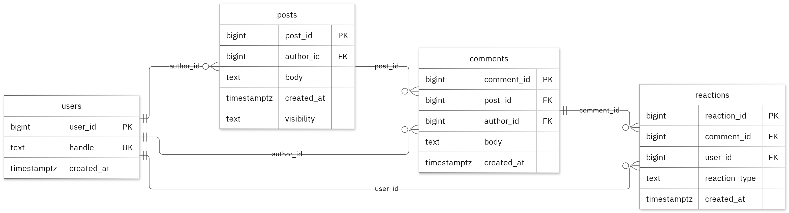

# MIT 8103 Advanced Database Systems

**Social Media / Comment System**  
**Student:** Lateef Olaleye  
**Student ID:** 301930160

## Case Study

My case study is a Social Media Comment System. I designed a database that allows members to publish posts, comment on posts, and react to comments. The system also supports the evaluation of relational queries, database constraints, transaction management, and an event-oriented MongoDB model.

The relational database consists of four main tables: `users`, `posts`, `comments`, and `reactions`.

**Users of the database:** members, who author posts and comments and add reactions, and platform administrators, who query the data for review and reporting.

**Major data stored:** users, posts, comments, and reactions in PostgreSQL, and comment activity events in MongoDB (`comment_events`). All records are fictional.

It supports the following operations:

- Creating and retrieving posts and comments.
- Retrieving recent comments on a particular post.
- Counting reactions on each comment.
- Adding reactions while preventing the same member from reacting to the same comment more than once.

## Portfolio 1: Database Design and Modelling

I organised the relational database design into four tables: users, posts, comments, and reactions. Primary keys uniquely identify records, while foreign keys maintain relationships between the tables. Additional constraints enforce the required business rules.

For example, a comment body must contain between 1 and 2,000 characters. The normalisation exercise demonstrates how the sample data is structured through First Normal Form (1NF), Second Normal Form (2NF), and Third Normal Form (3NF).

The constraint tests confirmed that all 13 deliberately invalid insert operations were rejected without affecting the valid sample records.

**Figure 1:** Tables, keys, and relationships. PK = Primary Key; FK = Foreign Key; UK = Unique Key.

## Portfolio 2: Query Processing and Optimisation

I executed three SQL queries against the sample records to demonstrate query processing and data retrieval across the relational tables. The JOIN query returned two records, linking comments to their corresponding posts.

For the indexing experiment, I used a separate dataset containing 20,000 synthetic performance-test records. The median lookup time decreased from 0.786 ms before indexing to 0.144 ms after indexing, representing an approximately 81.7% reduction in execution time.

Both phases returned the same records, while the execution plan confirmed that the newly created index was used. These results demonstrate how indexing can improve query performance, although the measured improvement applies specifically to the tested query and database environment.

## Portfolio 3: Transactions and Concurrency

I used a temporary counter on the reactions table to demonstrate COMMIT, ROLLBACK, and READ COMMITTED isolation.

The uncommitted update remained invisible to the other session, while ROLLBACK restored the previously committed value.

The concurrency exercise demonstrated a lost update scenario. Without locking, two concurrent increments resulted in a final counter value of 2 instead of the expected 3. With `SELECT FOR UPDATE`, Session B waited for Session A to complete before proceeding, and the final counter value was 3.

The temporary counter was used solely for this exercise; the original business fields in the case study remained unchanged.

## Portfolio 4: NoSQL and Advanced Data Models

I implemented an event-oriented MongoDB model using a collection named `comment_events` to represent activities associated with the case study.

The implementation inserted four sample events and returned the expected results for four queries. MongoDB schema validation rejected an invalid date type, while a duplicate event ID test confirmed that duplicate identifiers were not accepted.

The model uses embedded snapshots to keep related information alongside each event. The `details` field also accommodates different information depending on the event type.

These events are fictional examples used for the practical exercise. PostgreSQL remains responsible for enforcing the relational database rules.

## Portfolio 5: Distributed and Cloud Database Exercise

I proposed a distributed MongoDB architecture consisting of three replica-set members across separate failure zones.

The discussion covers primary elections, majority write acknowledgement, secondary replication lag, and the trade-offs associated with sharding the `comment_events` collection.

Replication supports database availability and fault tolerance, while backups provide an additional mechanism for disaster recovery. PostgreSQL would require its own availability and recovery strategy because it operates separately from MongoDB.

This portfolio uses the permitted discussion-based approach. No live replica set, cloud deployment, or failover test was implemented.

## Repository and Evidence

The complete portfolio, including SQL scripts, MongoDB implementation, explanations, query plans, result tables, and screenshots, is available in the GitHub repository:

**GitHub Repository:**  
https://github.com/Lafrosh73/Olaleye_Lateef_301930160

The repository is organised into separate folders for each portfolio activity to make the implementation and supporting evidence easier to review.

## Individual Reflection

Through this project, I gained practical experience in relational database design, query optimisation, transaction management, concurrency control, and NoSQL data modelling.

I learned the importance of organising relational data properly to reduce unnecessary duplication and maintain data integrity. The indexing exercise also demonstrated that query performance is not determined by the results alone, but by how the database executes a query.

The concurrency exercise helped me understand how simultaneous transactions can cause lost updates and how row-level locking can prevent this problem. I also gained a better understanding of how replication, availability, and sharding contribute to distributed database architecture.

A challenge I faced was that the generated comment-length check compared the comment body to a fixed sample string instead of enforcing 1 to 2,000 characters. I found this on final review, replaced it with a `char_length` rule, and reran the constraint tests. The lesson was to check that each constraint expresses the stated business rule, not only that the tests produce errors.

Overall, the project strengthened my understanding of how different database technologies and techniques can be applied to solve practical data management problems.

## AI-use Declaration

I used GitHub Copilot and the portfolio generator to assist with preparing the database model, scripts, and explanations.

The portfolio generator was used to run the PostgreSQL and MongoDB exercises, check their outputs, and capture result images. I remain responsible for reviewing, understanding, verifying, and explaining the submitted work.

I verified the AI-assisted output by reviewing the scripts and comparing each result with the expected outcome: the expected SQLSTATE codes for the 13 invalid inserts, identical result sets before and after indexing, counter values of 2 versus 3 in the concurrency test, and MongoDB error codes 121 and 11000. I also corrected the comment-length constraint after finding it did not match the stated rule.

## References

- PostgreSQL Documentation – Constraints: https://www.postgresql.org/docs/current/ddl-constraints.html
- PostgreSQL Documentation – EXPLAIN: https://www.postgresql.org/docs/current/using-explain.html
- PostgreSQL Documentation – Transaction Isolation: https://www.postgresql.org/docs/current/transaction-iso.html
- PostgreSQL Documentation – Explicit Locking: https://www.postgresql.org/docs/current/explicit-locking.html
- MongoDB Documentation – Data Modelling: https://www.mongodb.com/docs/manual/data-modeling/
- MongoDB Documentation – Replica Sets: https://www.mongodb.com/docs/manual/replication/
- MongoDB Documentation – Sharding: https://www.mongodb.com/docs/manual/sharding/
- Mermaid Documentation – Entity Relationship Diagrams: https://mermaid.js.org/syntax/entityRelationshipDiagram.html
